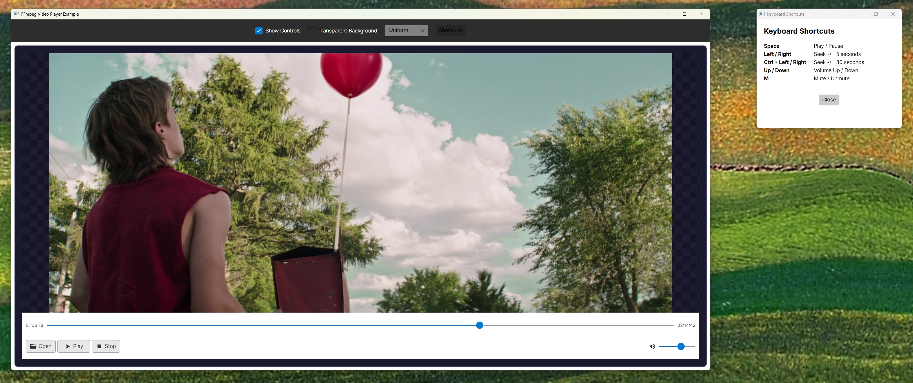

[](https://www.nuget.org/packages/FFmpegVideoPlayer.Avalonia/)
[](LICENSE)

# FFmpegVideoPlayer.Avalonia

Standalone FFmpeg media player for Avalonia 12. It owns source resolution, streaming,
playback lifecycle, cancellation and cleanup for local video/audio, HTTP media,
seekable streams, DASH manifests and YouTube URLs.



## Install

The working tree targets `3.1.0-preview.3`. Until that preview is published, pack it
locally and restore from the resulting package directory.

```bash
dotnet add package FFmpegVideoPlayer.Avalonia --version 3.1.0-preview.3
```

This preview requires **Avalonia 12.1.0+ (below 13)** and targets **.NET 10 only**. The single
package contains the Avalonia control, Core and OpenTK/OpenAL audio implementation;
applications do not reference separate player packages.

The managed player API is cross-platform, but the native payload is platform-specific:
FFmpeg 8.1.2 DLLs are bundled **only for Windows x64**. Windows x86/ARM64, macOS,
and Linux require a compatible system FFmpeg installation or an explicitly supplied
native-library path. OpenAL Soft audio DLLs are bundled separately for Windows x64,
x86, and ARM64.

YouTube video and audio are kept as separate adaptive streams, but FFmpeg reads the
signed media URLs directly with HTTP range requests. This avoids downloading the same
startup ranges through an intermediate proxy and preserves the selected stream's full
quality.

## Quick start

**1. Initialize FFmpeg** (e.g. in `Program.cs` before the app starts):

```csharp
using FFmpegVideoPlayer.Core;

FFmpegInitializer.Initialize();
```

**2. Add the control in XAML:**

```xml
xmlns:ffmpeg="clr-namespace:Avalonia.FFmpegVideoPlayer;assembly=Avalonia.FFmpegVideoPlayer"

<ffmpeg:VideoPlayerControl Source="C:\path\to\video.mp4" ShowControls="True" />
```

Video and audio-only files are both supported, for example `.mp4`, `.mov`, `.mp3`, `.wav`, `.flac`, `.ogg`, and `.m4a`.

`Source` also accepts direct HTTP(S) and YouTube URLs. Source changes are resolved
asynchronously and stale opens are cancelled automatically:

```xml
<ffmpeg:VideoPlayerControl
    Source="https://youtu.be/Ppejf4-YmSM"
    AutoPlay="True"
    ShowOpenButton="False" />
```

Applications with a small set of known tutorial videos can resolve their YouTube
metadata in the background. This does not download the full video; it reads metadata
and the small MP4 initialization/index ranges needed to prepare playback:

```csharp
await YouTubeMediaSourceResolver.Instance.PreloadAsync(
    "https://youtu.be/Ppejf4-YmSM",
    cancellationToken);
```

For custom headers, in-memory media or manifests, use the typed API:

```csharp
var source = MediaSource.FromUri(
    new Uri("https://media.example/video.mp4"),
    headers: new Dictionary<string, string> { ["Authorization"] = "Bearer …" });

var result = await player.OpenAsync(
    source,
    new MediaOpenOptions
    {
        OpenTimeout = TimeSpan.FromSeconds(20),
        ReadTimeout = TimeSpan.FromSeconds(30)
    },
    cancellationToken);
```

OpenAL Soft binaries for Windows x64, x86 and ARM64 are included in the package.

## FFmpeg

| Platform | Default |
|----------|---------|
| Windows x64 | Bundled DLLs in the package |
| Windows x86 / ARM64 | Compatible system FFmpeg 8 native libraries or a custom path |
| macOS (x64 / ARM64) | System/Homebrew (`brew install ffmpeg`); can auto-install |
| Linux (x64 / ARM64) | System packages (apt/dnf/pacman); can auto-install with passwordless sudo |

On every row except Windows x64, FFmpeg is a system/native prerequisite; it is not
contained in the NuGet package. Automatic installation, where supported, installs that
system prerequisite. The required FFmpeg 8 library ABI is `avcodec-62`, `avformat-62`,
`avutil-60`, `swresample-6`, and `swscale-9`.

Custom FFmpeg path:

```csharp
FFmpegInitializer.Initialize(customPath: @"C:\ffmpeg\bin", useBundledBinaries: false);
```

Subscribe to `StatusChanged` for progress during discovery or auto-install.

## Example

```bash
git clone https://github.com/jojomondag/FFmpegVideoPlayer.Avalonia.git
cd FFmpegVideoPlayer.Avalonia/examples/FFmpegVideoPlayerExample
dotnet run
```

## VideoPlayerControl

**Sources:** `Source` for a path/URL, or typed `Media` for reusable
`MediaSource` recipes.

**Lifecycle:** `PlaybackState`, `LastError`, `MediaOpening`, `MediaOpened`,
`FirstFramePresented`, `MediaFailed`, `PlaybackStateChanged`, and `MediaEnded`.

**Methods:** `OpenAsync`, `Open`, `OpenUri`, `CloseAsync`, `Play`, `Pause`,
`Stop`, `TogglePlayPause`, `Seek`, and `ToggleMute`.

**Presentation:** `AutoPlay`, `Volume`, `ShowControls`, `ShowOpenButton`,
`VideoStretch`, `VideoBackground`, `EnableKeyboardShortcuts`, `RenderingMode`
(`Cpu` / `OpenGL`), `AudioPlayerFactory`, and `IconProvider`.

**Shortcuts:** Space (play/pause), arrow keys (seek/volume), M (mute)

Set `AudioPlayerFactory` to customize or disable audio. OpenAL via OpenTK is the default.

Custom icons: implement `IIconProvider` and set `IconProvider`.

The included Material icon set can be selected without an extra icon dependency:

```xml
<ffmpeg:VideoPlayerControl
    Source="recording.mp4"
    IconProvider="{x:Static ffmpeg:MaterialVideoIconProvider.Instance}" />
```

Subscribe to `Diagnostic` to integrate playback and audio-output information with
your application's logger. It reports a player ID, timing, lifecycle kind and,
where applicable, stream information or audio sample rate/channel count. An audio
output failure is observable even when a video can continue silently. The default
OpenTK backend remains inside the library; `AudioPlayerFactory` is only needed for
a custom backend (return `null` to explicitly disable output).

```csharp
player.Diagnostic += (_, diagnostic) =>
    Debug.WriteLine($"{diagnostic.PlayerId}: {diagnostic.Kind}");
```

Diagnostics can arrive on worker threads. Marshal UI work to Avalonia's dispatcher.
Observer exceptions are isolated from playback. Nothing is written to disk
automatically; source metadata, error messages and exceptions may contain private
information, so redact them before persisting or sharing diagnostics.

Before application shutdown, capture the controls while their windows are still
attached and close them while the Avalonia dispatcher is running:

```csharp
var results = await MediaPlayerLifetime.CloseAllAsync(players);
foreach (var result in results.Where(result => !result.Succeeded))
    ReportCloseFailure(result.Exception);
```

Every distinct player is awaited even if another close fails. The helper does not
dispose the controls or shut down the application. `MediaFileTypes` in Core offers
case-insensitive audio/video extension hints; opening the actual source determines
codec support.

## Build from source

The repository builds with the .NET 10 SDK:

```bash
dotnet build FFmpegVideoPlayer.Avalonia.sln -c Release
dotnet test FFmpegVideoPlayer.Avalonia.sln -c Release --no-build
dotnet pack Avalonia.FFmpegVideoPlayer.csproj -c Release -o artifacts/packages
```

Build output and intermediates go under `artifacts/bin` and `artifacts/obj`.
The library's regression-test source is in `tests/`; tests and build output are
excluded from the NuGet package. The example is a standalone player demonstration.

Remove generated build files with PowerShell:

```powershell
./build/clean.ps1
```

This preserves NuGet packages and release records. Use `-WhatIf` to preview cleanup.

## License

The managed project code is licensed under MIT. The NuGet package also redistributes
FFmpeg and OpenAL Soft native libraries under their respective GNU LGPL terms. See
[`THIRD-PARTY-NOTICES.md`](THIRD-PARTY-NOTICES.md) for provenance, checksums, source
availability, replacement rights, and the packaged license-text locations.
